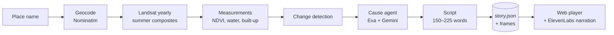

# Revisit

Type any place on Earth and get a 60–90 second narrated, sourced film of how it changed since 1984, and why.

> Landsat imagery courtesy of NASA and the U.S. Geological Survey.
>
> Supported by the Michigan Space Grant Consortium, NASA grant 80NSSC20M0124.

Built at Hack The Nest 2026. Rules: [`docs/REQUIREMENTS.md`](docs/REQUIREMENTS.md) · plan: [`docs/PLAN.md`](docs/PLAN.md) · formats: [`docs/CONTRACTS.md`](docs/CONTRACTS.md).

## What it does and why

- **The problem.** The biggest changes to the places we live happen too slowly to notice: a lake shrinks, farmland becomes subdivisions, a forest burns and grows back. Landsat has photographed every patch of land since the 1980s, but that archive is built for specialists, and even when you can see that a place changed, nothing tells you *why*.
- **What we do.** An agent reads about 40 years of Landsat imagery for the place you name, measures what changed and when (vegetation, water, built-up land), and looks for documented real-world events that line up with each change. The result is a short narrated film where every claim links to its source. When no cause is found, the evidence panel says so plainly, and the narration never guesses.
- **Who it's for.** Teachers and students who want a lesson about their own town, local journalists who need evidence of change, residents and planners asking "what was here before?", and anyone curious about where they grew up.

## How it works



1. **Geocode** the name with OpenStreetMap Nominatim. Several matches return a picker instead of a guess; open water is rejected.
2. **Imagery.** Search Landsat Collection 2 Level-2 on Microsoft Planetary Computer, one query per summer (June–September), and download the clearest scenes for a 6 km square ([ADR-001](docs/decisions/ADR-001-imagery-access.md)).
3. **Composites.** One per-pixel median image per summer, with cloud, shadow and snow masked and one fixed colour stretch for every year, so brightness changes are real ([ADR-002](docs/decisions/ADR-002-composite.md)). Years under 60% clear are skipped with a reason.
4. **Measurements** per year: mean NDVI over land, water fraction, built-up fraction.
5. **Change detection.** A place-wide layer (piecewise-linear segments) plus a local-patch layer (≥ 4 ha, fully flipped). A change must last ≥ 2 summers (burns excepted). At most 5 changes per story ([ADR-003](docs/decisions/ADR-003-change-detection.md)).
6. **Cause agent.** For each change: two cause-neutral Exa searches, then extract → verify → compose → check ([ADR-004](docs/decisions/ADR-004-causes.md)).
7. **Script and save.** A 150–225 word script is assembled, the story is validated against [`contracts/story.schema.json`](contracts/story.schema.json), and written to `data/stories/<id>/`.
8. **Narration** (web, server-side): each script segment is voiced by ElevenLabs with word timings, and cached next to the story.
9. **Web player** (`web/`, Next.js): a 3D globe to pick a place, live build progress, and a film player that syncs frames, narration and captions (see [The web app](#the-web-app)).

The backend and web app share only the contracts in [`contracts/`](contracts/). Disk is the source of truth, so saved stories play offline.

## The web app

Built by Vanessa in `web/` with Next.js (App Router), React, Tailwind CSS and React Three Fiber. Details: [`web/docs/FILMPLAYER.md`](web/docs/FILMPLAYER.md) and [`web/docs/NARRATION.md`](web/docs/NARRATION.md).

**Landing: a 3D globe.** A full-screen, textured, spinning Earth with stars and glowing markers for each story place (`components/Globe.tsx`, `LocationHotspot.tsx`). Choose a place by clicking its marker or from a dropdown (`PlacePicker.tsx`); a glass card shows the place and a Play button (`PlaceVideoPanel.tsx`). It respects "reduce motion".

**Search and live progress.** The search box (`SearchBox.tsx`) asks the backend for a story. A cached story opens straight away. A new one goes to `/build/[id]`, where a live feed follows the backend's build events over SSE (`ProgressFeed.tsx`) and opens the film when it's done.

**The film player** (`/story/[id]`, `components/FilmPlayer.tsx`, `lib/playback/`):

- **Audio drives the clock.** The narration audio is the source of truth; each segment's frames run from its `year_from` to `year_to`, spread evenly over that segment's audio (CONTRACTS §2). So the film slows down where the narration has more to say.
- **Crossfaded Landsat frames** with a large year label, one fixed colour stretch for every year.
- **The change holds.** In a change chapter, the last part of the segment holds on the change's `after_year`, so the result stays on screen.
- **Captions on by default,** one full sentence at a time, timed from the narration's word timings (`Captions.tsx`).
- **Controls:** play/pause and scrub; Space to play/pause; ← / → to step a year. The next segment's audio is prefetched for gapless playback.
- **Length check (HL-1):** a film over 95 s isn't played.

**Narration with ElevenLabs** (`app/api/narrate/route.ts`, `lib/narration/`):

- **Server-side only:** the ElevenLabs key never reaches the browser.
- **One request per script segment** to ElevenLabs' text-to-speech *with timestamps* endpoint, in one fixed voice (FR-45). The default model is `eleven_multilingual_v2`, with steady, slightly slowed settings for documentary narration.
- **Word timings:** ElevenLabs returns timings per character; `align.ts` turns them into word timings for the captions.
- **Cached:** the audio (`seg-XX.mp3`) and `narration.json` are written once to `data/stories/<id>/narration/`; replaying a story never calls ElevenLabs again. A narration over 95 s is rejected and not cached.
- **The text is never changed:** the narration speaks the backend's verified script exactly.

**Contract types** are generated from `contracts/*.schema.json` (`npm run types`), so the web app and backend agree on every field.

## Truthfulness

No claim reaches the film without a quote from a fetched page. The rules are in [REQUIREMENTS §4](docs/REQUIREMENTS.md#4-truthfulness-rules-no-hallucinations); the method is in [ADR-004](docs/decisions/ADR-004-causes.md).

**Checked in code (the model cannot override these):**

- **Quotes word for word (TR-2).** Every excerpt must appear verbatim in the page text. Not found → thrown out.
- **Place (TR-3).** The excerpt must name the place, its city or county, or a named feature inside the area. A state or country alone is not enough.
- **Years (TR-4).** The excerpt must fall within the change's years ±1, by a stated date or the page's publication date.
- **Numbers in the quotes.** Every number in a claim must appear in its own quotes, and so must words like "half", "doubled", "percent", "record" or "lowest". This stopped "a 51-foot drop" turning into "a record low".
- **No imagery-only claims.** Claims that describe the images or the source ("images were acquired…") are dropped.
- **Confidence by rule (TR-7).** `confirmed` = 2+ independent sources, or 1 authoritative (government, science, major newspaper); `likely` = 1 other source; otherwise `cause_unknown`. The model never sets it.
- **Script facts (TR-6).** Numbers, years and names in the narration come only from the metrics or verified excerpts.
- **Logging (TR-10).** Every model and search call is written to the story's `trace.jsonl`.

**Checked by a model:**

- **Extraction.** The model returns exact quotes only, from pages wrapped as untrusted data (TR-9). Code then verifies them as above.
- **Separate checker call (TR-5).** A second call sees each claim with only its own quotes and answers yes/no per claim. Any "no", a missing verdict or a failed call drops the claim.
- **One rewrite.** Failed claims go back once with the exact problem; rewrites must pass code and the checker again.

**What the viewer sees:**

- A change with no surviving claim is shown as **cause unknown** in the timeline and evidence panel (TR-8).
- The narration spends its time on changes with verified causes, never mentions a missing cause, and never fills a gap with a guess.
- Every claim opens its exact quote, source and confidence in one click.

## Data sources

| Source | Used for | Link |
| --- | --- | --- |
| Landsat Collection 2 Level-2 surface reflectance, Landsat 4, 5, 7, 8 and 9 | All imagery and measurements | [USGS product page](https://www.usgs.gov/landsat-missions/landsat-collection-2-level-2-science-products) |
| Microsoft Planetary Computer (`landsat-c2-l2` STAC + data API) | Scene search and download | [Dataset page](https://planetarycomputer.microsoft.com/dataset/landsat-c2-l2) |
| OpenStreetMap Nominatim | Geocoding | [nominatim.org](https://nominatim.org/) · [usage policy](https://operations.osmfoundation.org/policies/nominatim/) |
| Exa | Web search with page text, for causes | [exa.ai](https://exa.ai/) |
| Google Gemini (default `gemini-3.5-flash-lite`) | Text model for the cause agent, via Gemini's OpenAI-compatible endpoint | [OpenAI compatibility docs](https://ai.google.dev/gemini-api/docs/openai) |
| ElevenLabs | Narration (web side, server-only key) | [elevenlabs.io](https://elevenlabs.io/) |

- **Dates:** summers (June–September), 1984–2026.
- **Scaling (DR-1):** reflectance = DN × 0.0000275 − 0.2, applied in our code to the raw values.
- **Per-frame record (DR-2):** each frame stores its sensors, scene ids, dates and clear-sky %.
- **Map data** © OpenStreetMap contributors.

## Gold test places

Defined in [`eval/gold_places.yaml`](eval/gold_places.yaml). Expectations are hypotheses until checked by eye; `verified` says which were.

| Place | What it tests |
| --- | --- |
| Lake Mead, Nevada | Water loss 2000–2015 (drought); check against published reservoir records |
| Paradise, California | Burn, 2018 (Camp Fire) |
| Summerlin, Nevada | Desert suburb growth, which our data shows as **greening** (NDVI 0.10 → 0.21, 1991–2019) |
| Palm Jumeirah, Dubai | Water to land, 2001–2006 (land reclamation) |
| Central Park, New York | **Control.** Must produce zero changes (it does) |
| Willow Run, Michigan | Bomber plant demolition (2014–15) and test track paving (2016–18): small local patches |
| Delray, Detroit, Michigan | Gordie Howe bridge construction; bright new concrete masking. Not yet independently verified |
| Ypsilanti, Michigan | Small-town news coverage; no fixed expectations |

On the reviewed gold set, the combined detector found 7/7 expected changes with 0 at the control (ADR-003), and the cause agent found 5/7 expected causes with 0 unsupported claims (ADR-004).

## Running it

Commands use Git Bash on Windows. On macOS/Linux, use `.venv/bin/python` instead of `.venv/Scripts/python`.

### Backend

Python 3.12 (geo wheels aren't reliable on 3.13+ yet). From `backend/`:

```bash
py -3.12 -m venv .venv
```

```bash
.venv/Scripts/python -m pip install -r requirements.txt
```

Copy [`.env.example`](.env.example) to `.env` at the **repo root** and fill it in. For real stories set `EM_MOCK=0`, and put a contact email in `NOMINATIM_USER_AGENT` (Nominatim's usage policy asks clients to identify themselves). Keys are read only from `.env`, never committed.

```bash
.venv/Scripts/python -m uvicorn app.main:app --port 8000
```

Check it with `http://localhost:8000/api/health`. The API is described in [CONTRACTS §1](docs/CONTRACTS.md#1-http-api-backend-httplocalhost8000).

### Playing pre-built stories offline

On a machine that has built stories, from `backend/`:

```bash
.venv/Scripts/python scripts/package_demo.py
```

This writes `data/revisit-stories.zip` with only the player files (story.json, frames, thumbs, masks, narration, gallery index). Copy it to the other machine's repo root, then from there:

```bash
python -m zipfile -e revisit-stories.zip data/stories/
```

Then start the backend as above. No API keys or network are needed to play saved stories.

### Building new stories

- **Any place, live:** search it in the web app. The backend geocodes, builds within the 180 s timeout, and streams progress.
- **Imagery only** (frames and measurements, no keys besides Nominatim's user agent):

```bash
.venv/Scripts/python scripts/build_imagery.py "Lake Mead, Nevada"
```

- **The gallery** (needs `EXA_API_KEY` and `GEMINI_API_KEY`). The script first prints, per place, how many Exa searches are cached (free) and how many would be paid, the estimated cost, and the project ledger. Without `--live` it runs with `EXA_CACHED_ONLY=1`, so it cannot spend money; changes needing a paid search stay `cause_unknown`.

```bash
.venv/Scripts/python scripts/build_gallery.py
```

```bash
.venv/Scripts/python scripts/build_gallery.py --live --only willow-run
```

- **Cost plan.** About $0.01 per Exa search, at most 2 per change (≤ 10 per story), so about $0.07–0.10 per new story. A hard project-wide cap ($15, in `backend/app/agent/search.py`) refuses any search that would pass it. Cached searches cost nothing. Per-story limits (HL-10): ≤ 15 Exa and ≤ 25 LLM calls; over budget, the remaining changes become `cause_unknown`.

Validate any story after a pipeline change:

```bash
.venv/Scripts/python scripts/validate_story.py ../data/stories/lake-mead-nevada-us-6km/story.json
```

### Mock mode

`EM_MOCK=1` in `.env` serves the made-up contract sample (`sample-lake-6km`, marked `[SAMPLE]`) and replays sample build events, with no keys. Saved stories in `data/stories/` are still served by id.

### Web app

Owned by Vanessa; see [`web/README.md`](web/README.md) and [`web/docs/PHASE0.md`](web/docs/PHASE0.md). From `web/`, copy `.env.local.example` to `.env.local` and set:

- `NEXT_PUBLIC_API_BASE=http://localhost:8000` (the backend)
- `ELEVENLABS_API_KEY`, `ELEVENLABS_VOICE_ID`, `ELEVENLABS_MODEL_ID` (server-side only; needed only to create narration for a story that doesn't have it yet)
- `DATA_DIR=../data` (shared with the backend, for the cached narration)

Then:

```bash
npm install
```

```bash
npm run dev
```

Then open `http://localhost:3000`.

## Limits

Plain statements of what this can and can't show (DR-8).

- **30 m pixels.** No single buildings. A change smaller than about 4 ha or narrower than about 60 m isn't reported (Willow Run's 1–2-pixel-wide runways are visible by eye but not detected).
- **Causes are documented coincidences, not proof.** We show events that line up in time and place with a measured change.
- **Desert suburbs show as greening.** Our built-up index counts bare desert as built, so building a suburb makes "built-up" fall while lawns and trees raise NDVI.
- **"Urban growth" often means cleared land,** not finished buildings. Bare ground passes the built-up test, so the text says "cleared or built over" and the narration doesn't claim buildings.
- **Falls in built-up usually mean regrowth,** since bare fields and quarries score as built. They're never told as demolition without a source.
- **Dates can be a summer early.** Composites are summer snapshots (Willow Run's demolition shows in 2014; records say Sept 2014 – Jan 2015). Cause matching allows ±1 year.
- **Short reversals** (one or two summers) are deliberately not reported.
- **Landsat 7 stripe gaps and cloud holes are left grey.** They are never filled from other years, because that would put another year's pixels on this year's date. Each frame records its clear %. Landsat 7 stays in because without it 2012 has no data.
- **Sensor switches.** A change within 1 year of a Landsat switch needs ≥ 2 later switch-free summers and is flagged as a possible artefact (DR-6).
- **Reprojection.** Scenes stored in a neighbouring UTM zone are resampled (nearest neighbour), so their pixels aren't on the original grid. Fine at 30 m.
- **Masking edge cases.** Haze isn't in the Landsat QA bits; hazy scenes are demoted, not removed. Some single-year holes over dark water remain.
- **Recall depends on web coverage.** Two cause-neutral searches per change; small local changes often stay `cause_unknown`, which is the honest answer. Extraction varies run to run.
- **The checker is a model too.** It can pass a subtle overreach or drop a true claim; the code rules hold regardless, and every quote is shown next to its claim.
- **Exa budget.** A fixed project-wide spending cap; once reached, new changes stay `cause_unknown` until searches are cached.
- **Gemini rate limits.** Several simultaneous builds are slower, not less truthful.
- **Out of scope:** oceans and ice sheets, predictions.

## Decisions

- [ADR-001](docs/decisions/ADR-001-imagery-access.md) Imagery access: Planetary Computer data API, one parallel STAC query per year (stackstac as fallback).
- [ADR-002](docs/decisions/ADR-002-composite.md) Yearly composites: per-pixel median, full QA mask plus S2b fixes, 6 km default area, holes never filled.
- [ADR-003](docs/decisions/ADR-003-change-detection.md) Change detection: combined place-wide segments + local ≥ 4 ha patches; 0 changes at the control.
- [ADR-004](docs/decisions/ADR-004-causes.md) Causes: extract → verify in code → compose → separate checker, with confidence by rule.

## Team and tools

- **Harman:** backend, data pipeline, cause agent (`backend/`, `contracts/`, `eval/`, `spikes/`).
- **Vanessa:** web app, 3D globe, film player, captions and ElevenLabs narration (`web/`).

AI tools used (event rules, REQUIREMENTS §6):

- **Claude Code** for the backend, contracts, spikes and docs.
- **Cursor** for the web app.
- **At runtime:** Google Gemini (`gemini-3.5-flash-lite` by default) for quote extraction, claim composing, checking and rewriting, through [`backend/app/llm.py`](backend/app/llm.py); `LLM_PROVIDER=openai` switches to OpenAI with no code change. Exa for web search. ElevenLabs for the narration voice. No image-generation models: every frame is real Landsat imagery.

## Repo layout

```text
Hack-The-Nest/
├── backend/
│   ├── app/pipeline/     geocode, imagery, composite, render, metrics, changes, story, build
│   ├── app/agent/        search (Exa), causes, verify, trace, prompts/
│   ├── app/              FastAPI app (main.py), llm.py, config.py, mock mode
│   ├── scripts/          build_imagery, build_gallery, package_demo, validate_story
│   └── tests/            pytest suite
├── contracts/            JSON schemas + made-up samples shared by backend and web
├── docs/                 PLAN, REQUIREMENTS, CONTRACTS, decisions/ (ADRs)
├── eval/                 gold_places.yaml
├── spikes/               S1–S4 comparison code and results
├── web/                  Next.js app (Vanessa): app/ pages + /api/narrate, components/ (globe,
│                         player, captions), lib/ (playback, narration, generated types)
└── data/                 git-ignored: stories, frames, caches
```
