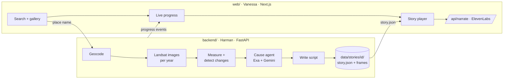

# Earth Memory: Build Plan

**Hack The Nest 2026 · Sat Nov 14, 12 PM → Sun Nov 15, 12 PM (Eastern)**

## What we're building and why

**Earth Memory: type any place on Earth and get a 60–90 second narrated, sourced film of how that spot changed since 1984, and why.**

**The problem.** The biggest changes to the places we live happen too slowly to notice: a lake shrinks, farmland becomes subdivisions, a forest burns and grows back. The proof exists, because NASA and USGS's Landsat satellites have photographed every patch of land since the 1980s. But that archive is built for remote-sensing specialists. Even when you can see that a place changed, nothing tells you *why*.

**What we do about it.** An agent reads 40 years of Landsat imagery for the place you name, measures what changed and when (vegetation, water, built-up land), and finds documented real-world events that explain each change. It narrates the result as a short film with every claim linked to its source. When it can't find a cause it says so, instead of guessing.

**Who it's for.** Teachers and students who want a lesson about *their* town, local journalists who need evidence of how a place changed, residents and planners asking "what was here before?", and anyone curious about where they grew up.

**Why it stands out.**

- **Personal:** every judge has a hometown, and the demo builds theirs live.
- **Real science:** real pixels, real dates, measured change, checked against published records. No AI-generated images.
- **Honest AI:** claims come only from source text checked word for word, and "cause unknown" is shown plainly.
- **Needs an agent:** measuring change, then finding and checking its cause for any place in 90 seconds can't be done by hand.

Rules: [`REQUIREMENTS.md`](REQUIREMENTS.md). Formats: [`CONTRACTS.md`](CONTRACTS.md).

## Team

| Who | Tool | Owns |
| --- | --- | --- |
| **Harman** | Claude Code | `backend/`, `contracts/`, `eval/`, `spikes/`: everything that *makes* a story |
| **Vanessa** | Cursor | `web/`: everything that *shows* a story, plus narration |

**Event deadlines:** Devpost draft by **Sat midnight** · final by **Sun 12 PM** (no late entries) · demos **Sun 1:15 PM**.

## Architecture



- **One contract** between the halves: the backend writes `story.json`, the web app plays it. See `CONTRACTS.md`.
- **Disk is the source of truth**, so cached stories play offline. MongoDB only mirrors the gallery list.
- **The agent never writes from memory.** Claims come only from source text checked word for word (REQUIREMENTS §4).

## Phases

### Phase 0: Setup

Goal: both of us can build without waiting on each other.

- **Both:** get API keys (Exa, ElevenLabs, Gemini, MongoDB Atlas) into local `.env` files; agree on the contract. The agent runs on Gemini (`LLM_PROVIDER=gemini`).
- **Harman:** backend skeleton with a **mock mode** that serves the sample story and replays sample progress events; fill in the test places in `eval/gold_places.yaml`.
- **Vanessa:** Next.js skeleton; generate types from `contracts/`; load the sample story through a typed API client.

✅ Done when the web app shows the sample story from the mock backend.

### Phase 1: Core

Goal: real satellite pixels in a real player.

- **Harman:** run spikes S1–S3 with subagents (imagery access, clean yearly images, change detection) and build the winners: place lookup → yearly frames → measurements → detected changes → progress events.
- **Vanessa:** search page and gallery, place picker, live progress page, film player (crossfade, year label, scrub), timeline with chapter markers, metric chart. All against mock mode.

✅ Done when a real Lake Mead story (frames, measurements, changes) plays in the player. **If this isn't working by about 9 PM, drop live generation and demo only pre-built stories.**

### Phase 2: Full loop

Goal: place → film with narration and sources, end to end.

- **Harman:** spike S4 (causes without hallucination), then the cause agent, chapters with confidence, and the 150–225 word script.
- **Vanessa:** spike S5, then ElevenLabs narration with cached audio, word-synced captions; switch from mock mode to the real backend.
- **Both:** run one place end to end, **submit the Devpost draft before midnight**, record a backup demo video.

✅ Done when one place goes from search to narrated film with clickable sources.

### Phase 3: Polish (overnight, sleep in shifts)

Goal: a demo that can't fail.

- **Harman:** Gemini image check, validation against a published record, pre-build 6–8 stories for the gallery, speed tuning.
- **Vanessa:** evidence panel, before/after slider, offline test with Wi-Fi off, visual polish and error states.

✅ Done when every cached story plays offline, narrated, with sources.

### Phase 4: Ship (Sunday morning)

Goal: submitted and rehearsed.

- **Feature freeze around 9 AM.** Bug fixes only after that.
- **Harman:** README (how to run, data sources, credit line, limits).
- **Vanessa:** demo video ≤ 3 min; optional domain and deployment.
- **Both:** rehearse the 2-minute table demo; each person explains the other's half; **submit final on Devpost by 11:30 AM**.

✅ Done when the REQUIREMENTS §8 checklist is ticked.

## If we run short, cut in this order

1. "Ask the place" voice Q&A
2. Before/after slider
3. MongoDB mirror
4. Gemini image check
5. Live generation (demo pre-built stories only)

**Never cut:** source verification, "cause unknown" honesty, the player, narration, credit lines.

## Repo structure

```text
Hack-The-Nest/
├── CLAUDE.md · .cursor/rules/      # instructions for each AI tool
├── docs/                           # PLAN, REQUIREMENTS, CONTRACTS, decisions/
├── contracts/                      # JSON schemas + samples (shared, change only by agreement)
├── backend/app/
│   ├── pipeline/                   # geocode, imagery, composite, render, metrics, changes, run
│   └── agent/                      # search, verify, vision, chapters, script, prompts/
├── backend/scripts/                # build_cached.py, validate_story.py
├── eval/gold_places.yaml           # test places for spikes
├── spikes/                         # subagent comparison code
├── web/app/                        # page.tsx, build/[id], story/[id], api/narrate
├── web/components/ · web/lib/      # player pieces; generated types + API client
└── data/                           # git-ignored: stories, frames, audio
```

## Working together

- Each of us stays in our own folder; contract changes are agreed first.
- Merge to `main` at the end of each phase, after checking it still runs.
- Post in our chat when a phase is done or blocked.
